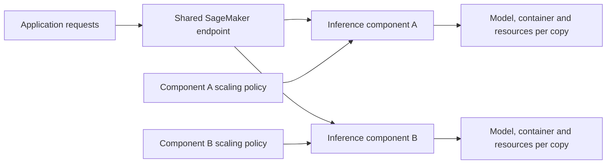
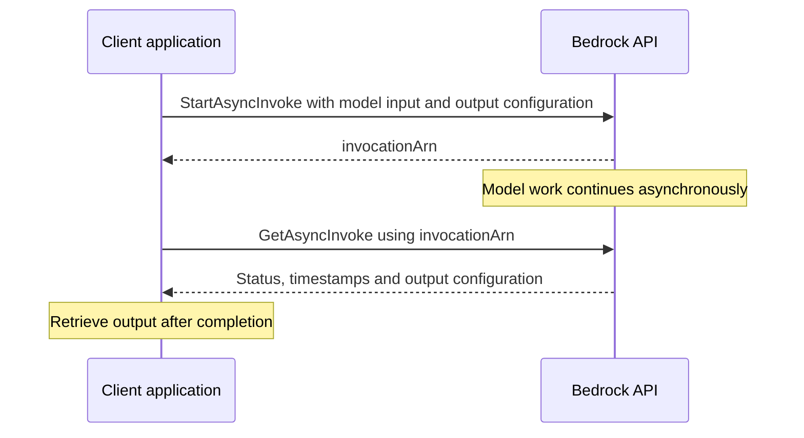

# AWS Inference Infrastructure

**My engineering work on Amazon SageMaker and Amazon Bedrock, including foundation-model hosting and asynchronous inference.**

At AWS, I built ML inference infrastructure and worked directly with enterprise customers to develop, train and optimize models using PyTorch and Hugging Face. The work connected model quality and training performance with the practical constraints of memory, compute utilization, inference cost and deployment.

This repository documents that work through public product references. AWS implementation source is proprietary and is not included here.

## Amazon SageMaker: foundation-model hosting

I worked on the inference capabilities described in the [SageMaker launch announcement](https://aws.amazon.com/blogs/aws/amazon-sagemaker-adds-new-inference-capabilities-to-help-reduce-foundation-model-deployment-costs-and-latency/).

Serving a foundation model involves more than running a prediction. Each model needs compute and memory, request traffic changes over time, and unused capacity increases the cost of hosting. These capabilities let customers deploy multiple models on a shared endpoint while assigning resources and scaling policies to each model.

The public design introduces **inference components**, which specify the model, its container, the resources reserved for each copy, and the number of copies to deploy. This gives customers more control over sharing infrastructure without forcing every model to scale identically.

AWS's launch announcement reported an average 50% reduction in model deployment costs and an average 20% reduction in inference latency for the announced capabilities.

### Public serving model

This summarizes the published product model rather than internal AWS service architecture. Per-component resource reservations and copy counts separate a model's serving requirements from the endpoint's shared capacity. Independent scaling matters when models on the same infrastructure have different traffic patterns or memory footprints.

## Amazon Bedrock: asynchronous invocation

I also worked on asynchronous model hosting for long-running workloads, including the capability exposed through [Bedrock's StartAsyncInvoke API](https://docs.aws.amazon.com/bedrock/latest/APIReference/API_runtime_StartAsyncInvoke.html).

Asynchronous invocation separates submitting a request from retrieving its eventual result. The API starts an invocation, accepts an output configuration, and returns an invocation ARN. That request lifecycle lets an application track work without holding a synchronous inference response open until completion.

The engineering concern is the lifecycle of the work: accepting a request, identifying it, exposing its status and making the result available. The linked API reference documents the public contract.

### Asynchronous request lifecycle

[`GetAsyncInvoke`](https://docs.aws.amazon.com/bedrock/latest/APIReference/API_runtime_GetAsyncInvoke.html) exposes `InProgress`, `Completed`, or `Failed`, along with timestamps and a failure message where applicable. An accepted submission and a completed model job are separate events. Applications need to retain the invocation ARN and handle the eventual status explicitly.

| Contract element | Role in the client lifecycle |
| --- | --- |
| `modelId` and `modelInput` | Select the model and provide its workload-specific input |
| `outputDataConfig` | Identify the output configuration for the invocation |
| `invocationArn` | Correlate submission with subsequent status retrieval |
| `status` and `failureMessage` | Distinguish ongoing work, completion, and failure |
| Submission and end timestamps | Observe the asynchronous lifecycle |

The sequence and field descriptions come from the public API contract. They do not expose internal queues, worker topology, retry policy, or other proprietary implementation details.

## Broader engineering work

My AWS work also included model development and optimization with enterprise customers, and automation of regional rollout workflows for SageMaker inference. It gave me experience working across both the models and the infrastructure needed to run them.

## Public references

| Reference | What it demonstrates |
| --- | --- |
| [SageMaker launch announcement](https://aws.amazon.com/blogs/aws/amazon-sagemaker-adds-new-inference-capabilities-to-help-reduce-foundation-model-deployment-costs-and-latency/) | Inference components, shared endpoints, resource allocation, scaling and the service-level results reported by AWS |
| [Bedrock StartAsyncInvoke](https://docs.aws.amazon.com/bedrock/latest/APIReference/API_runtime_StartAsyncInvoke.html) | The public asynchronous-invocation request and response contract |

This is an engineering case study, not an AWS sample application or a repository of AWS source code. The product references document capabilities I contributed to; the work was delivered by AWS teams.

[My portfolio](https://github.com/Jaiashar) · [PennOS systems implementation](https://github.com/Jaiashar/penn-os)
